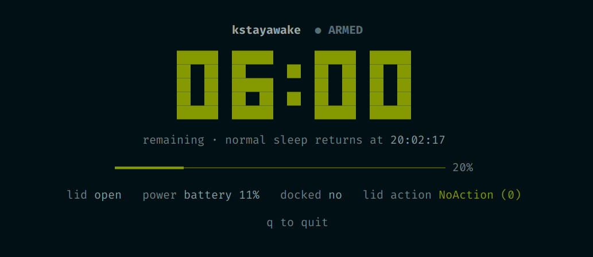
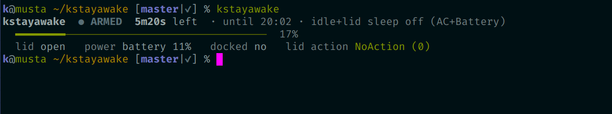

<p align="center">
  
</p>

# kstayawake

Keep laptop awake temporarily even if the lid is closed.

Let's me access agents with [airc](https://github.com/Kynde/airc) or let
some number crunching complete when the laptop is stowed away in a bag or backseat.

## Usage

```
kstayawake N        no sleep for N minutes
kstayawake off      restore to normal settings now
kstayawake status   show whether armed and the time remaining (default)
kstayawake tui      live full-screen countdown (q to quit)
kstayawake tui N    arm for N minutes and open the tui (or: kstayawake N tui)
kstayawake --help   show this help
```

Re-running while armed resets the countdown (`20m left + kstayawake 15` → `15m`).
When the timer runs out — or on an explicit `off` — normal power settings are
restored and, if the lid is still closed, the machine suspends.

<p align="center">
  
</p>

## How it works

Entirely user-space, **no sudo**: while armed, the tool flips PowerDevil's lid
and auto-suspend actions to *NoAction* (leaving the LowBattery profile alone), and
runs a countdown in a transient `systemd --user` unit that restores the original
settings when it expires.

See [docs/how-it-works.md](docs/how-it-works.md) for the full mechanism —
snapshot/restore, the KConfig reload gotcha, suspend semantics, state files, and
test hooks.

## Install

Symlink the script onto your `$PATH` and the completion into a directory on
your zsh `$fpath`:

```sh
ln -s ~/kstayawake/bin/kstayawake          ~/bin/kstayawake
ln -s ~/kstayawake/completions/_kstayawake ~/.zsh/completion/_kstayawake
```

Then restart zsh (or `rm -f ~/.zcompdump*; compinit`) to pick up completions.

## Requirements

- KDE Plasma with PowerDevil
- `kreadconfig6` / `kwriteconfig6` (KDE Frameworks 6)
- `qdbus-qt6`
- `systemd` user instance

Currently only supports KDE Plasma 6 (PowerDevil) on Linux, but the concept can
be ported or adapted to other systems. Feel free to submit PRs for GNOME, macOS,
or other suggestions.

Also I only wrote the completions for zsh, but PRs for bash/fish are welcome.

## License

[MIT](LICENSE)

